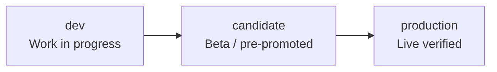
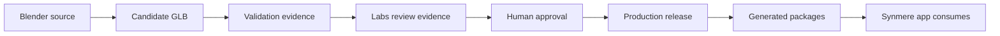
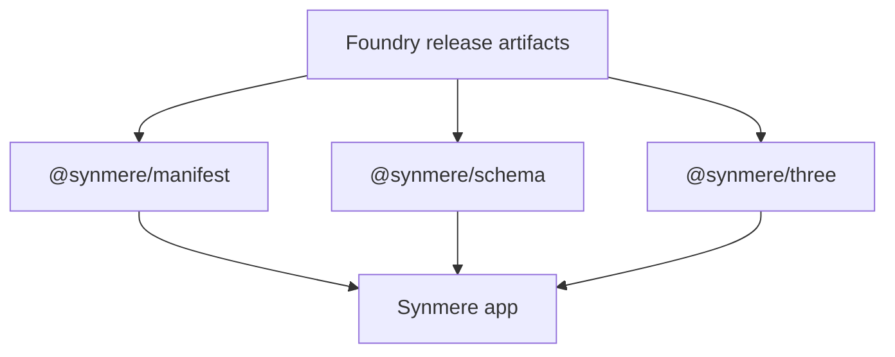

# Foundry workflow

This document is the operating map for how authored assets move through
Synmere Foundry and become consumable by the Synmere app.

## Foundry boundary

Foundry owns:

- canonical source assets;
- candidate exports;
- validation evidence;
- review evidence;
- immutable promoted releases;
- release manifests and promotion records;
- generated portable packages consumed by Synmere.

The Synmere app consumes Foundry output. It must not mutate Foundry manifests,
promote assets, write release records, or infer asset visibility from validation
wording.

## Asset lifecycle

All app-facing assets use one canonical stage field:

```ts
type FoundryAssetStage = "production" | "candidate" | "dev";
```

```text
dev → candidate → production
```

- `dev`: work-in-progress, local, provisional, or unverified.
- `candidate`: beta, pre-promoted asset.
- `production`: live verified asset.



`stage` is separate from `validation.status`, which is one of:

```ts
type FoundryAssetValidationStatus = "passed" | "needs-review" | "blocked";
```

See [asset-stages.md](asset-stages.md) for the full stage contract.

## Shell asset flow

The current IdentityShell source of truth is:

```text
assets/source/identity-shell/identity-shell-v1.blend
```

The normal shell release path is:

```text
Blender source
  → candidate GLB
  → contract + morph validation
  → Labs review
  → explicit approval
  → immutable production release
  → generated packages
  → Synmere app update
```



### 1. Export a candidate

```sh
pnpm asset:shell:export
```

This exports:

```text
assets/candidates/current/identity-shell-v1.glb
assets/candidates/current/identity-shell-v1.manifest.json
```

The candidate manifest is stage `candidate`.

### 2. Validate the candidate

```sh
pnpm asset:shell:validate
```

This checks the GLB contract and morph-safety matrix. Validation evidence stays
under `assets/candidates/current/`.

### 3. Review in Synmere Labs

```sh
pnpm shell:review
```

The review command:

- exports the current candidate;
- validates contract and morph safety;
- serves the candidate from Foundry;
- opens Synmere Labs Shell with the candidate asset;
- runs candidate browser checks;
- captures Preview, Trace, and Topology evidence;
- writes `assets/candidates/current/identity-shell-v1.review.json`.

Review does not promote and does not write into Synmere `public/`.

### 4. Approve the reviewed candidate

```sh
pnpm shell:approve -- --confirm
```

Approval records a human decision against the exact reviewed candidate hash. It
does not copy or promote assets.

### 5. Promote an immutable release

```sh
pnpm asset:shell:promote -- --version <x.y.z> --confirm
```

Promotion requires:

- semantic version;
- passed validation;
- passed Labs review;
- explicit approval;
- matching candidate/review hashes;
- no existing release directory for the target version.

Promotion writes:

```text
assets/releases/identity-shell/<version>/identity-shell.glb
assets/releases/identity-shell/<version>/source/identity-shell.blend
assets/releases/identity-shell/<version>/manifest.json
assets/releases/identity-shell/<version>/promotion-record.json
```

The promoted release manifest and promotion record are stage `production`.

### 6. Build package outputs

```sh
pnpm packages:build
```

or individually:

```sh
pnpm schema:build
pnpm three:build
pnpm manifest:build
```

Package outputs are generated from Foundry-owned source/release artifacts. Do
not edit generated package files as the source of truth.

## Avatar candidate flow

Avatar assets are output candidates, not IdentityShell replacements.

The current test lane is:

```text
original authored asset
  → dev-stage candidate folder
  → converted GLB
  → candidate manifest
  → Labs Avatar inspection
  → license/topology/rig review
  → candidate or rejection decision
```

Test avatar assets live under:

```text
assets/candidates/avatar/test/
```

Build the local test candidates with:

```sh
pnpm avatar:test:build
```

Dev avatar candidates:

- use `stage: "dev"`;
- use `validation.status: "needs-review"` until proven otherwise;
- may have `unknown` source/license metadata, but required metadata fields must
  still exist;
- must not be product-facing;
- must not be treated as promoted.

Before an authored avatar can become `candidate` or `production`, Foundry needs:

- license/source verification;
- topology and material review;
- rig/morph/adapter review;
- validation renders;
- adapter mapping evidence;
- explicit promotion decision.

## Package boundaries

Foundry generates three portable packages:

- `@synmere/schema`
- `@synmere/three`
- `@synmere/manifest`



### `@synmere/schema`

Exposes portable schema/types such as shell parameters and release-manifest
shape.

### `@synmere/three`

Exposes Three.js validation helpers for released scenes.

### `@synmere/manifest`

Exposes app-facing release and promotion records, including:

- `identityShell`
- `IDENTITY_SHELL_RELEASES`
- `ASSET_RELEASES`
- `ASSET_PROMOTIONS`
- `FOUNDRY_ASSET_STAGES`

## Synmere app consumption

The Synmere app should consume Foundry output through packages and immutable
asset URLs.

Expected app behavior:

```text
install @synmere/manifest
  → read release records
  → interpret stage
  → load release GLB URL
  → validate scene contract
  → render in Studio or Labs
```

The app should not:

- modify Foundry records;
- promote assets;
- write release manifests;
- infer visibility from validation text;
- treat `dev` assets as verified;
- treat avatar assets as IdentityShell replacements.

## Pre-merge checks

Before merging Foundry changes, run:

```sh
pnpm manifest:build
pnpm schema:build
pnpm three:build
pnpm check
```

For shell candidate work, also run the review flow before approval/promotion:

```sh
pnpm shell:review
```

For avatar test-candidate changes, run:

```sh
pnpm avatar:test:build
```

when source assets or conversion scripts change.
